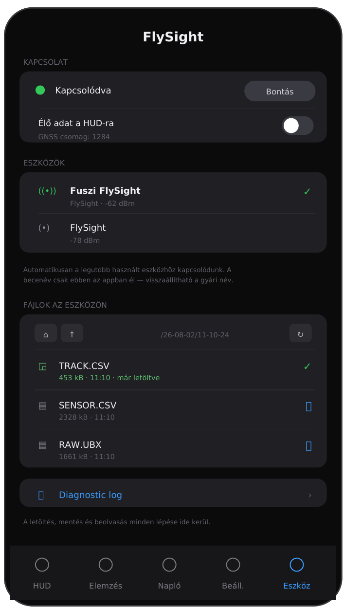
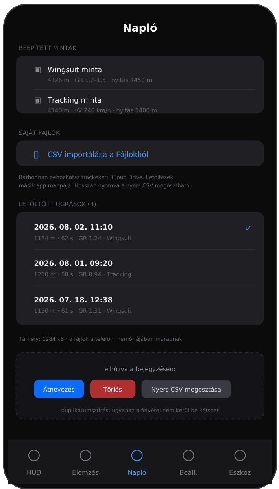
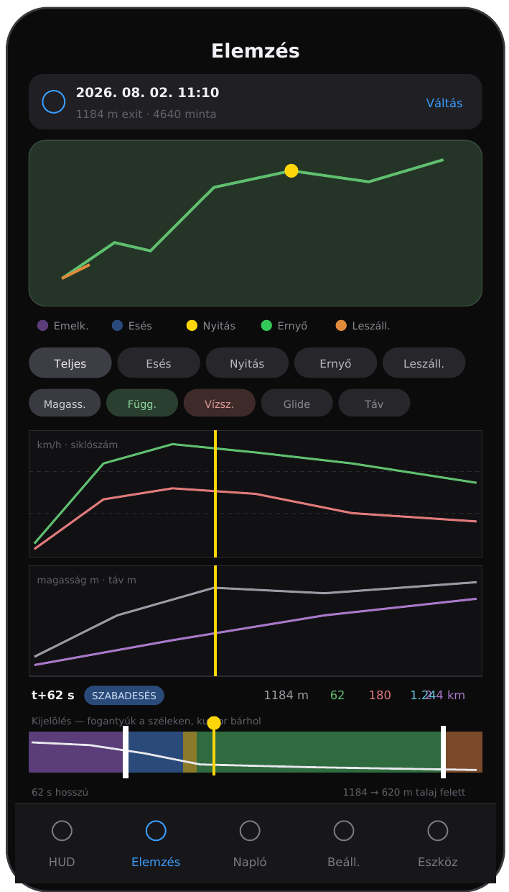
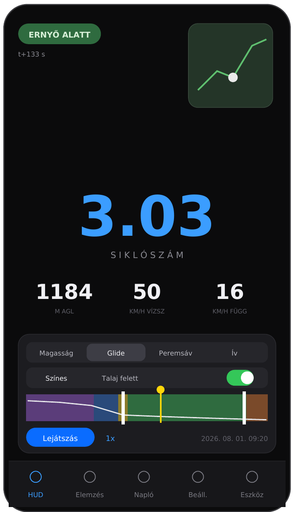
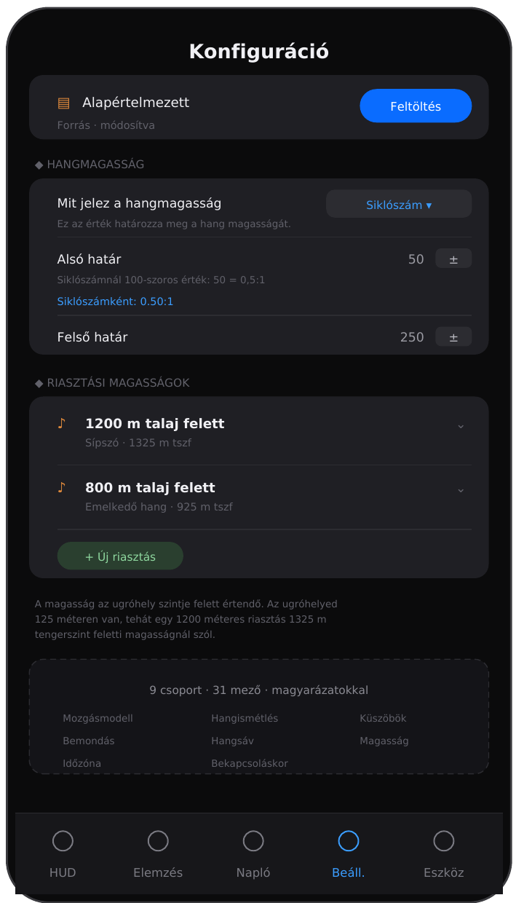

[English](user-guide.md) | **Magyar**

# FlySight Explorer — felhasználói útmutató

A FlySight Explorer iOS alkalmazás a FlySight 2 GPS-loggerhez: ugrásadatok
letöltése Bluetooth-on, elemzés, HUD-megjelenítés és az eszköz konfigurálása —
mindezt a telefonról, kártyaolvasó és számítógép nélkül.

> Az alábbi képek a kód alapján készült sematikus makettek, nem
> képernyőképek — a valódi felület apróbb részletekben eltérhet.

## Tipikus használat

1. **Eszköz** fül: kapcsolódj a FlySighthoz (a legutóbb használt eszközhöz az
   app automatikusan kapcsolódik).
2. A **Fájlok az eszközön** listában egy mappára koppintva belépsz, egy fájlra
   koppintva letöltöd. A már letöltött felvétel zöld pipát kap, és nem töltődik
   le újra.
3. A letöltött ugrás megjelenik a **Napló** fülön.
4. Az **Elemzés** fülön térképen és grafikonokon nézheted meg, a **HUD** fülön
   pedig visszajátszhatod.
5. A **Beállítás** fülön szerkesztheted és visszatöltheted a FlySight
   `CONFIG.TXT` fájlját.

Az alsó sávban öt fül van: **HUD**, **Elemzés**, **Napló**, **Beállítás**,
**Eszköz**.

---

## Eszköz (FlySight) fül

- Több eszköz becenévvel, automatikus kapcsolódás. A becenév csak ebben az
  appban él — visszaállítható a gyári név.
- Élő adat továbbítása a HUD-ra (kapcsoló a Kapcsolat részben).
- Fájlböngésző az eszköz SD-kártyáján.
- A már letöltött fájlok zöld pipát kapnak.
- Innen nyílik a diagnosztikai napló: a letöltés, mentés és beolvasás minden
  lépése ide kerül. Hibabejelentéshez ezt érdemes csatolni.

## Napló fül

- Beépített minták (wingsuit és tracking) és a letöltött ugrások.
- Import a Fájlokból: iCloud Drive, Letöltések, más app mappája.
- Egy bejegyzést elhúzva: átnevezés, törlés, nyers CSV megosztása.
- Duplikátumszűrés az eszköz útvonala alapján — ugyanaz a felvétel nem kerül be
  kétszer.
- A fájlok a telefon memóriájában maradnak.

## Elemzés fül

- Térkép a nyomvonallal, fázisonként színezve (emelkedés, esés, nyitás, ernyő,
  leszállás).
- Két grafikon: sebesség / siklószám, valamint magasság / táv.
- Öt szakasz-preset: teljes ugrás, esés, nyitás, ernyő, leszállás.
- A kurzor alatt élő értékek, köztük a megtett táv.
- A grafikonon koppintással és vízszintes csúsztatással mozgathatod a kurzort.
- Alul a fázissáv: a széleken lévő fogantyúkkal jelölhetsz ki szakaszt.

## HUD fül

- Négy elrendezés: Magasság, Glide, Peremsáv, Ív.
- Nagy, messziről is olvasható értékek.
- Lejátszás 1–10× sebességgel, kistérképpel.
- Alul a fázissáv: kijelölés fogantyúkkal, sárga kurzor.
- Választható, hogy a magasság a talaj felett vagy tengerszinten értendő.

## Beállítás fül

- A teljes `CONFIG.TXT`: 9 csoport, 31 mező.
- Minden mezőhöz magyarázat és mértékegység.
- A riasztási magasságok az ugróhely szintjéhez mérve: ha az ugróhely 125
  méteren van, egy 1200 méteres riasztás 1325 m tengerszint feletti
  magasságnál szól.
- Letöltés az eszközről, szerkesztés, visszatöltés. A feltöltés felülírja az
  eszközön lévő `CONFIG.TXT`-t.

---

## Technikai részletek

A Bluetooth-protokoll, a párosítás és keepalive, valamint a fejlesztés közben
talált hibák leírása: [technikai dokumentáció](architecture.hu.md).
