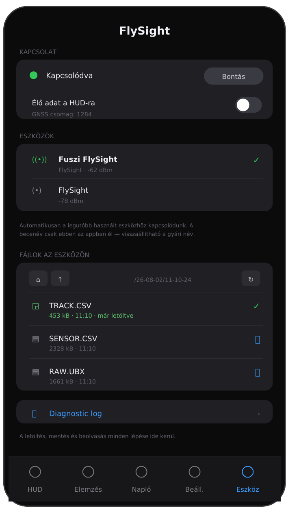
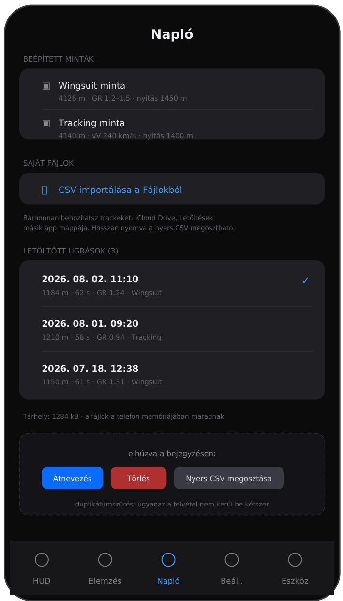
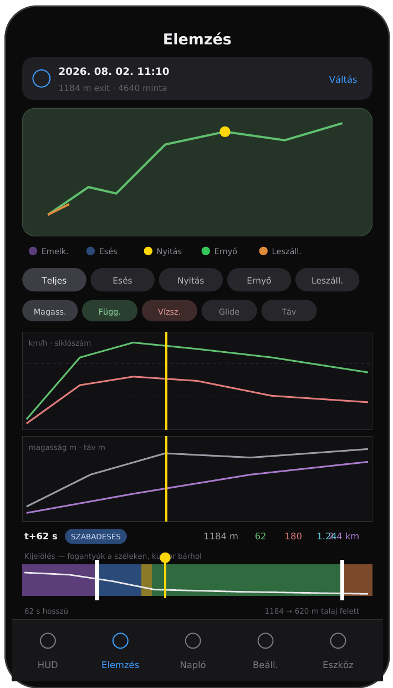
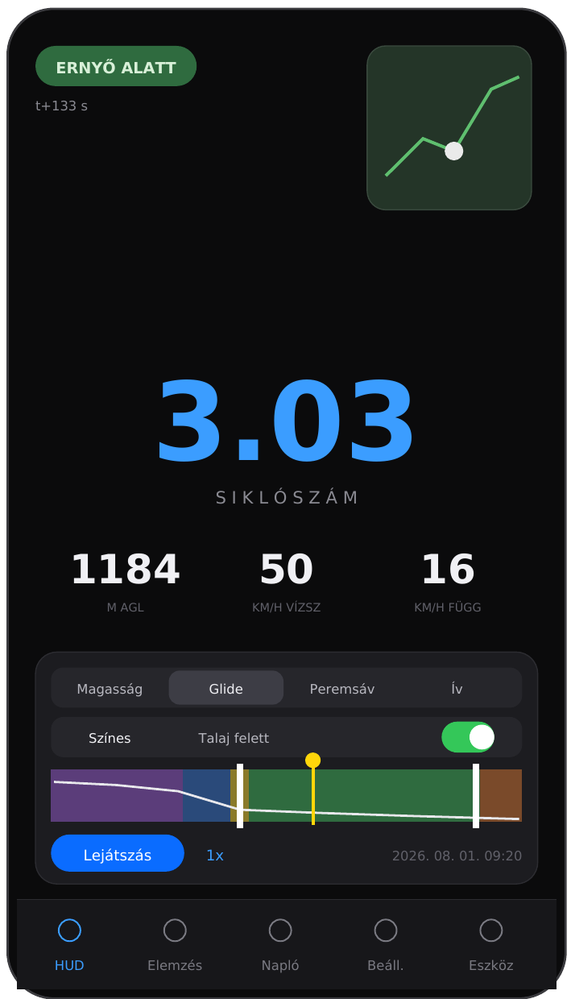
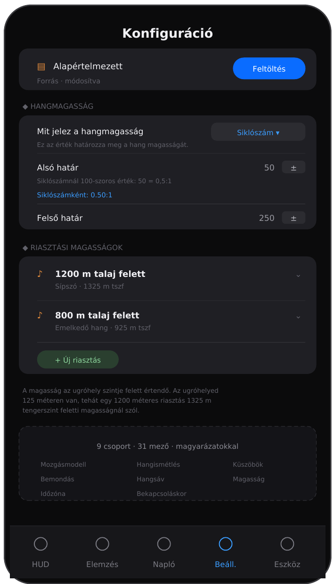

**English** | [Magyar](user-guide.hu.md)

# FlySight Explorer — User guide

FlySight Explorer is an iOS app for the FlySight 2 GPS logger: download your
jumps over Bluetooth, analyse them, replay them on a HUD and configure the
device — all from your phone, no card reader or computer needed.

> The pictures below are schematic mockups drawn from the code, not
> screenshots, and they show the Hungarian interface. The real app may differ
> in small details. The app can be switched between English and Hungarian.

## Typical workflow

1. **Device** tab: connect to your FlySight (the app automatically connects to
   the device you used last).
2. In **Files on device**, tap a folder to open it and tap a file to download
   it. Downloaded recordings get a green check mark and are not downloaded
   again.
3. The downloaded jump appears in the **Logbook** tab.
4. Look at it on a map and charts in the **Analysis** tab, or replay it in the
   **HUD** tab.
5. Edit the FlySight's `CONFIG.TXT` in the **Settings** tab and upload it back
   to the device.

The tab bar has five tabs: **HUD**, **Analysis**, **Logbook**, **Settings**,
**Device**.

---

## Device (FlySight) tab

- Multiple devices with nicknames, automatic connection. Nicknames only exist
  in this app — you can always restore the factory name.
- Stream live data to the HUD (switch in the Connection section).
- File browser for the device's SD card.
- Files you have already downloaded get a green check mark.
- Opens the diagnostic log: every download, save and read step is logged
  here. Please attach it when you report a bug.

## Logbook tab

- Built-in samples (wingsuit and tracking) and your downloaded jumps.
- Import from the Files app: iCloud Drive, Downloads, another app's folder.
- Swipe an entry to rename it, delete it or share the raw CSV.
- Duplicate detection based on the file's path on the device — the same
  recording is never added twice.
- Files stay in your phone's storage.

## Analysis tab

- Map with the flight path, coloured by phase (climb, freefall, deploying,
  canopy, landing).
- Two charts: speed / glide ratio, and altitude / distance.
- Five segment presets: whole jump, freefall, opening, canopy, landing.
- Live values under the cursor, including distance covered.
- Tap or drag horizontally on a chart to move the cursor.
- Phase bar at the bottom: drag the handles at its edges to select a section.

## HUD tab

- Four layouts: Altitude, Glide, Edge bar, Dial.
- Large values that are readable from a distance.
- Playback at 1–10× speed with a mini map.
- Phase bar at the bottom: select with the handles, yellow cursor.
- Choose whether altitude is shown above ground or above sea level.

## Settings tab

- The complete `CONFIG.TXT`: 9 groups, 31 fields.
- Every field has an explanation and its unit.
- Alarm altitudes are relative to the dropzone's elevation: if the dropzone is
  at 125 m, a 1200 m alarm sounds at 1325 m above sea level.
- Load from the device, edit, upload back. Uploading overwrites the
  `CONFIG.TXT` on the device.

---

## Technical details

The Bluetooth protocol, pairing and keepalive, and the bugs found during
development are described in the [technical documentation](architecture.md).
